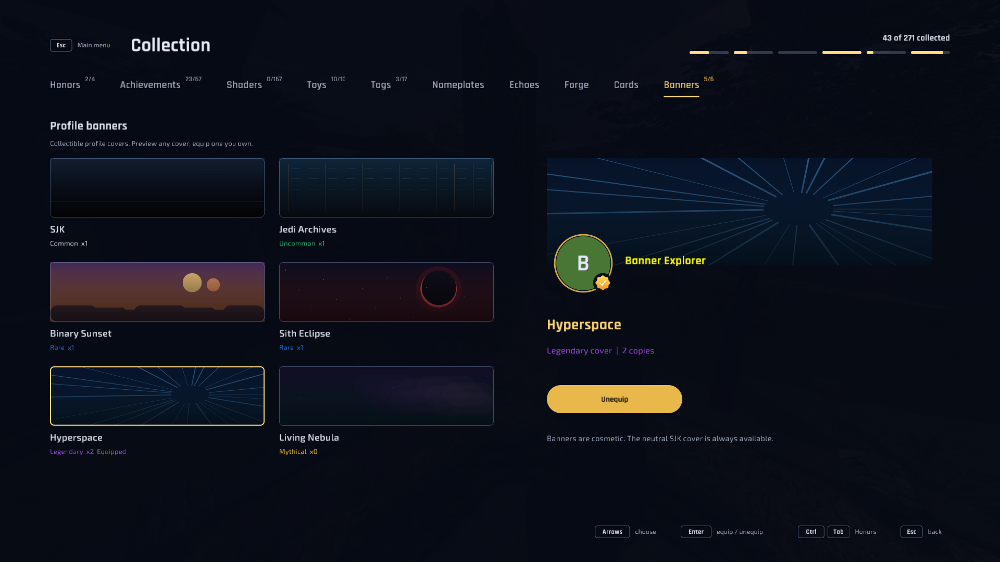
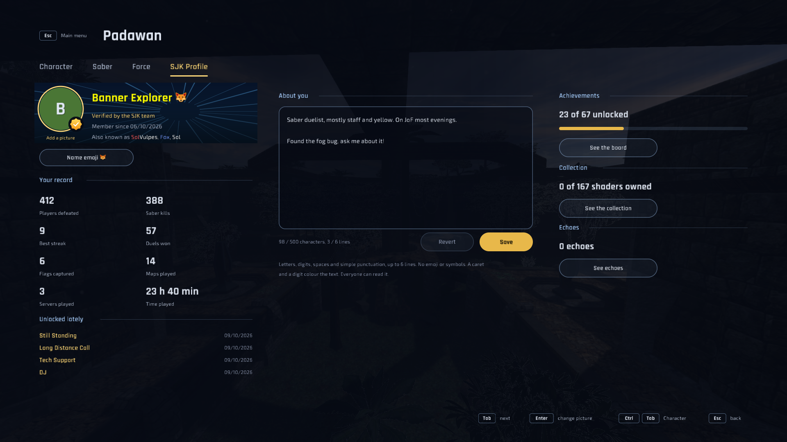
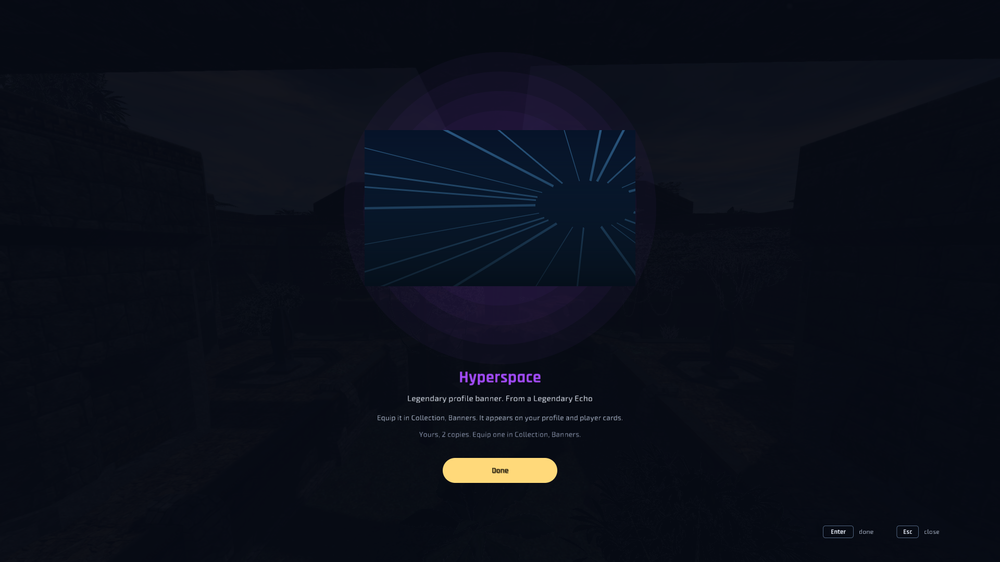
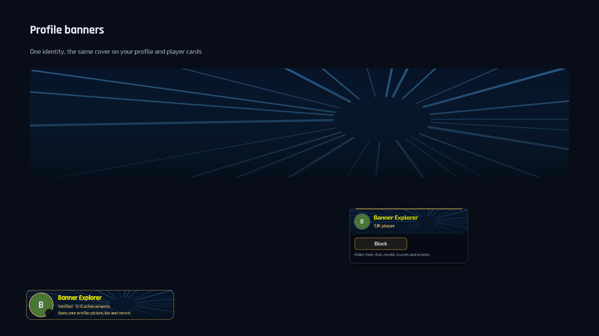

# Profile banners

Static, collectible profile covers, implemented by the client/hub feature PRs
following [design proposal #311](https://github.com/Sol-Vulpes/SJK/pull/311).
They are cosmetics on the SJK identity, independent of the game server and protocol 26.
The live hub must support the matching additive contract before banners can drop.

## Collection and profiles

Collection > Banners previews every cover, with its rarity, owned copy count and
an enlarged profile header. Equip sends a signed request to the hub; selecting an
equipped cover and choosing Unequip returns to the neutral SJK cover. Locked covers
can be previewed but cannot be equipped. The neutral cover is always available.
Offline/disabled identity cannot change equipment. A refused request is shown on the
page; the client does not pretend equipment was saved locally.

The personal Profile header and the main/in-game menu profile card show the cover.
Chat sender cards use the same cover from their cached profile lookup, with a shallow
central crop. Avatar, name colours, badges, bio, medals and actions keep their existing
layout. Every menu style uses these SJK controls. A dark veil keeps text readable.
There is no animated version in this first set and no motion setting is needed.

## First edition

| Permanent id | Cover | Tier | Original native UI art |
| --- | --- | --- | --- |
| `banner_jedi_archives` | Jedi Archives | Uncommon | Navy archive columns and gold lines |
| `banner_binary_sunset` | Binary Sunset | Rare | Two warm suns and layered dunes |
| `banner_sith_eclipse` | Sith Eclipse | Rare | A red-rimmed dark disc and embers |
| `banner_hyperspace` | Hyperspace | Legendary | Blue star trails converging off centre |
| `banner_living_nebula` | Living Nebula | Mythical | Violet/teal clouds and stars |

The empty id selects the free neutral SJK cover. The catalogue is in
[profile_banner.rs](../crates/sjk-viewer/src/profile_banner.rs), mirrored by the hub's
banner unlock entries. Art uses bounded native draw commands, with one shared renderer
for covers of every size. No downloaded assets, arbitrary URLs or commercial-game art.

## Echo rewards and ownership

Banners use the existing holocron/Echo opening transaction and counted unlock inventory.
The banner bonus chance is **100 per mille (10%)** in every holocron tier,
rolled independently on top of the ordinary prize. Card frequency, credits, Solar
blade bonuses, shaders, tags and shard piles retain their existing rules. The hub
sends its actual odds and the loot table shows them; before a supporting hub
supplies odds, the client's bonus chance is zero. The ordinary prize is revealed
first, followed by any bonus cover.
Kyber crystals keep their existing shader-only behavior.

The hub rolls the banner tier using the opening's `shader_tier` odds, with the same
fallback as tags (nearest available commoner tier, otherwise the commonest above).
No Common banner exists, so a Common roll falls back to Uncommon. Within the selected
tier it prefers covers the person lacks; after all are held, copies stack. The reveal
shows the cover, name, rarity and count, and points to Collection > Banners.

Trading, crafting, selling and shattering banners are unavailable, as for tags;
existing blade-only inventory actions do not silently accept a new cosmetic kind.
The hub validates the authenticated person's ownership on equip. Removing the last
copy clears equipment; regaining a copy does not automatically equip it. Profile
reads also validate supported ownership, so an invalid id never becomes a worn cover.

## Compatibility and verification

Public profiles add optional `banner`; old JSON reads as neutral. Signed
`PUT /v1/profile/banner` accepts `{"id":"banner_jedi_archives"}` (empty to unequip)
and returns the authoritative profile, under the ordinary profile-edit request quota.
Openings add optional `Opened.banner` beside the ordinary prize; loot tables add
optional `banner` bonus odds per mille. The
client ignores unknown covers and displays the neutral cover. Bonus banners add no public grand-find announcements. The hub enables drops only
for a configured minimum supporting client release; older clients keep opening
normally without bonuses. Deployment remains Sol's responsibility.

Focused tests cover ownership, unsupported ids, duplicate and atomic openings,
replay refusal, removing the last copy, old profile JSON, neutral fallbacks,
worker commands and UI equip/unequip/locked behavior. Windows x64 source revision
`4d4f9a42` passed formatting, locked workspace build/tests and all-target clippy.
Windowless GPU fixtures verified Collection, the profile header and Echo reveal
without canvas overflow; a CPU component snapshot checked both player-card sizes
and their focus borders. Profile tests cover narrow windows and maximum text size.
Deployment and live interoperability remain unverified; there is no gameplay or
performance certification. Other players' cards use the existing cached profile
lookup; this version does not add live banner-change broadcasts.

## Screenshots

Offline GPU fixtures with a synthetic profile:

CPU component preview (the snapshot renderer approximates atlas badges):

